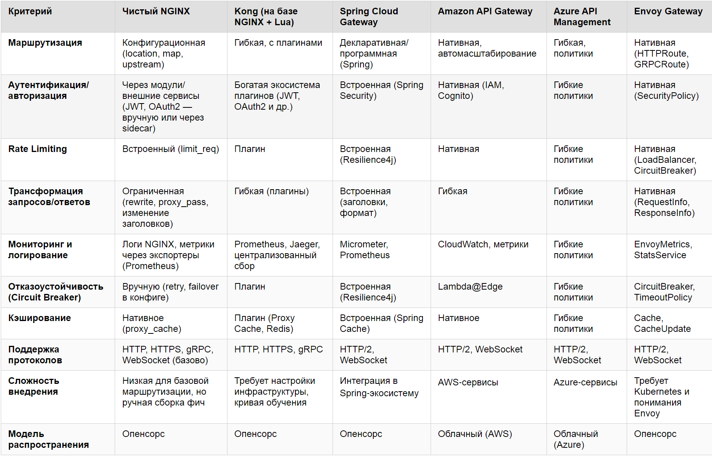
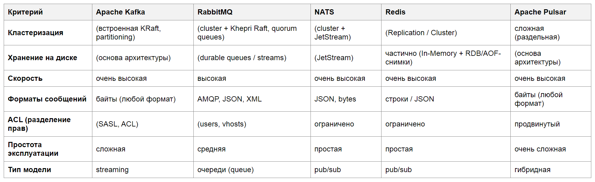
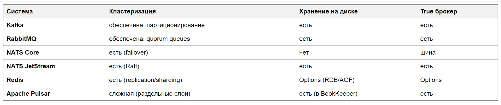

# Домашнее задание к занятию «Микросервисы: принципы»
## Обязательная часть
### Задание 1.
Наиболее подходящие решения это Nginx и Kong на его базе, но предпочтительнее чистый nginx, так как больше возможностей для кастомной настройки под конкретный проект. На рисунке 1.1 представлена сравнительная таблица всех решений.</br>
Маршрутизация - NGINX даёт прозрачную и предсказуемую маршрутизацию через текстовые конфиги (location, map, upstream). Вся логика видна в одном месте, без скрытых абстракций: ты чётко понимаешь, какой запрос куда пойдёт и по какому условию. Это удобно, если ты привык сам писать инструкции и держать инфраструктуру под полным контролем.</br>
Аутентификация/авторизация - NGINX позволяет гибко интегрировать авторизацию через внешние сервисы (например, Keycloak, Auth0) либо через njs‑скрипты, сохраняя полный контроль над процессом. Ты сам определяешь, как валидировать JWT или OAuth2, и не зависишь от готовых плагинов или вендорских политик.</br>
Rate Limiting - встроенный модуль limit_req обеспечивает эффективное ограничение частоты запросов на низком уровне: он работает быстро, потребляет минимум ресурсов и позволяет тонко настраивать лимиты по IP, заголовкам и другим параметрам.</br>
Трансформация запросов/ответов - NGINX поддерживает базовые, но важные трансформации прямо в конфиге: изменение заголовков, редиректы (rewrite), подстановку переменных и перенаправление через proxy_pass. Для простых и предсказуемых преобразований этого достаточно, а сложная логика выносится в бэкенд — так архитектура остаётся понятной.</br>
Мониторинг и логирование - логи NGINX имеют стандартный, легко читаемый формат, а метрики удобно собирать через экспортеры (например, nginx‑exporter) в Prometheus. Это позволяет быстро строить дашборды в Grafana или интегрировать данные в привычные схемы мониторинга.</br>
Отказоустойчивость (Circuit Breaker) - с помощью директив вроде proxy_next_upstream, retry и настройки upstream‑групп можно реализовать понятные сценарии отказоустойчивости: автоматическое переключение на резервные бэкенды и повторные попытки. Всё это задаётся явно в конфиге и легко отслеживается.</br>
Кэширование - нативное кэширование через proxy_cache работает эффективно и предсказуемо: ты можешь детально настроить ключи кэша, TTL, условия валидации и поведение при ошибках. Это снижает нагрузку на бэкенд и даёт полный контроль над тем, что и как кэшируется.</br>
Поддержка протоколов - NGINX стабильно и нативно поддерживает основные протоколы — HTTP, HTTPS, gRPC и WebSocket. Реализация этих протоколов в NGINX зрелая и хорошо протестированная, поэтому не нужно подключать дополнительные компоненты для базовой работы.</br>
Сложность внедрения - внедрение NGINX простое и воспроизводимое: конфигурация хранится в обычных текстовых файлах, которые удобно версионировать в Git и применять через Ansible или собственные скрипты. Деплой сводится к обновлению конфигов и reload’у — это хорошо ложится на подход с собственными инструкциями и автоматизацией.</br>
Модель распространения - NGINX — опенсорс‑решение без вендор‑лока: его можно одинаково надёжно использовать на Ubuntu, в Docker, на bare metal или в любых облаках. Ты не привязываешься к конкретному провайдеру или экосистеме, и можешь переносить конфигурацию между средами без адаптации под вендорские ограничения.</br>

</br>
Рисунок 1.1. Сравнительная таблица различных решений.</br>
Примеры конфигураций:</br>
1. Маршрутизация запросов.</br>
Берем URL сервиса и работаем с ним: по URL отправляем в нужный сервис.</br>
```
http {
    upstream security {
        server security:8080;
        }
    upstream uploader {
        server uploader:3000;
        }
    server {
        listen 80;
        location /v1/user {
            proxy_pass http://security;
            }
        location /v1/token {
            proxy_pass http://security;
            }
        location /v1/upload {
            proxy_pass http://uploader;
            }
        }
    }
```
реализуется:</br>
    - routing based on path</br>
    - конфигурационный роутинг (код минимальный)</br>
2. Проверка аутентификации (auth_request)</br>
Перед основным запросом проверяем сервис проверки токена.</br>
```
server {
    listen 80;
    location = /auth {
        internal;
        proxy_pass http://security/v1/token/validation;
        proxy_pass_request_body off;
        proxy_set_header Content-Length "";
        proxy_set_header Authorization $http_authorization;
        }
    location /v1/upload {
        auth_request /auth;
        proxy_pass http://uploader;
        }
    }
```
реализуется:</br>
    - проверка JWT через внешний сервис</br>
    - отказ при 401/403 автоматически</br>
3. Терминация HTTPS</br>
Используем TLS re-encryption (end-to-end HTTPS) — когда NGINX не просто "равертывает" HTTPS, а перешифровывает трафик заново к бэкенду.</br>
```
http {
    upstream backend {
        server backend:8443;
    }
    server {
        listen 443 ssl;
        ssl_certificate /etc/nginx/certs/gateway.crt;
        ssl_certificate_key /etc/nginx/certs/gateway.key;
    location / {
        proxy_pass https://backend;
        # проверка сертификата backend
        proxy_ssl_verify on;
        proxy_ssl_trusted_certificate /etc/nginx/certs/ca.crt;
        # SNI
        proxy_ssl_server_name on;
        }
    }
}
```
NGINX:</br>
    - расшифровывает клиентский HTTPS;</br>
    - проверяет/обрабатывает запрос (auth, routing);</br>
    - создаёт новое HTTPS соединение к сервису.</br>

## Задание 2
Таблица брокеров сообщений представлена на рисунке 2.1:</br>

</br>
Рисунок 2.1. Брокеры сообщений.</br>
Кластеризация. Apache Pulsar. У Pulsar самая совершенная архитектура кластеризации. В отличие от Kafka (где данные и логика совмещены на одних узлах), Pulsar разделяет слои вычислений (бесстейт-брокеры) и хранения (кластер BookKeeper). Это позволяет масштабировать диски отдельно от процессоров, а также из коробки поддерживает георепликацию между дата-центрами и настоящую мультиарендность (изоляцию tenants).</br>
Хранение на диске. Apache Kafka. • Хранение на диске — это фундамент её надежности (дисковый распределенный лог). Kafka оптимизирована для работы с дисками на низком уровне с помощью технологии Zero-Copy (передача данных в сеть напрямую из дискового кэша ОС, минуя память приложения). Она способна стабильно хранить петабайты сообщений годами, выполняя последовательную запись со скоростью дискового массива.</br>
Скорость (Latency — минимальная задержка). Redis. Так как Redis работает целиком в оперативной памяти (In-Memory), у него физически нет конкурентов по времени доставки одного сообщения. Задержки (latency) составляют микросекунды. Если системе нужно передавать сообщения практически со скоростью света, дисковые брокеры здесь проигрывают.</br>
Форматы сообщений. RabbitMQ. Обладает самой высокой «всеядностью» и гибкостью на уровне протоколов и метаданных. Он нативно поддерживает сложные свойства сообщений (заголовки, TTL, приоритеты, атрибуты маршрутизации) для форматов AMQP, MQTT и STOMP. Это позволяет приложениям гибко упаковывать и размечать JSON, XML или бинарные структуры без написания кастомных оберток.</br>
ACL (Разделение прав). RabbitMQ. Предлагает максимально понятную, глубокую и удобную для DevOps изоляцию из коробки. С помощью концепции виртуальных хостов (vhosts) внутри одного физического кластера можно создать полностью независимые «песочницы» для разных команд разработки. Права доступа гибко настраиваются на чтение, запись и конфигурирование конкретных очередей и обменников по регулярным выражениям.</br>
Простота эксплуатации. NATS (Core / JetStream). Абсолютный фаворит DevOps-инженеров по удобству поддержки. Весь брокер — это один легкий бинарный файл, написанный на Go. Ему не нужны JVM, тяжелые базы метаданных или внешние координаторы. Он потребляет мегабайты памяти, запускается за секунду одной командой и идеально ложится в концепцию легковесной инфраструктуры Kubernetes.</br>
Тип модели. Apache Pulsar. Если оценивать тип модели с точки зрения архитектурных возможностей, Pulsar объединяет в себе лучшее из двух миров. Он может работать и как Streaming (непрерывный лог событий, как Kafka), и как классические Очереди (с Push-доставкой и конкурирующими потребителями, как RabbitMQ). Это избавляет компанию от необходимости держать два разных брокера под разные задачи.</br>
Таблица сравнения критериев брокеров сообщений представлена на рисунке 2.2:</br>

</br>
Рисунок 2.2. Критерии брокеров сообщений.</br>
1. Кластеризация. Механизм объединения нескольких узлов в единую распределённую систему с целью: повышения отказоустойчивости (failover), масштабирования (горизонтального), распределения нагрузки. Реализуется через репликацию, партиционирование или консенсус-протоколы (например, Raft).</br>
2. Хранение на диске. Способность системы сохранять сообщения на персистентный носитель (диск), обеспечивая: устойчивость к сбоям (durability), возможность восстановления после перезапуска, гарантированную доставку (at-least-once / exactly-once).</br>
3. True "истинный" брокер (True Message Broker)
Система считается «честным брокером», если она:</br>
- принимает сообщения от продюсера;</br>
- гарантированно хранит их (обычно на диске);</br>
- управляет доставкой потребителям;</br>
- отслеживает подтверждения (acknowledgements);</br>
- исключает потерю сообщений при сбоях.</br>

Если система лишь передаёт сообщения без гарантированного хранения (in-memory, best-effort) — это шина сообщений (message bus), а не «честный брокер».</br>
Интерпретация строк:</br>
Kafka: Распределённый журнал событий с партиционированием; обеспечивает устойчивое хранение и строгие гарантии доставки.</br>
RabbitMQ: Классический брокер сообщений с очередями (quorum queues), ориентирован на надёжную маршрутизацию и подтверждение доставки.</br>
NATS Core: Лёгкая шина сообщений; обеспечивает быструю доставку без персистентности → не является полноценным брокером.</br>
NATS JetStream: Расширение NATS с добавлением персистентности и консенсуса (Raft); превращает систему в полноценный брокер.</br>
Redis: In-memory хранилище с опциональной персистентностью (RDB/AOF); брокерские функции ограничены, гарантии доставки не строгие.</br>
• Apache Pulsar: Распределённая гибридная платформа (streaming + очереди) со сложной многослойной кластеризацией; за счет выделенного слоя хранения (Apache BookKeeper) гарантирует устойчивое сохранение данных на диске и является полноценным «честным брокером» корпоративного уровня.</br>
Итог:</br>
- есть диск + есть гарантии ==> брокер.</br>
- нет диска или гарантий ==> шина.</br>
